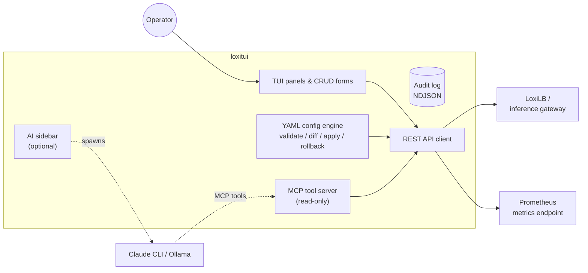

# loxitui

[](https://github.com/loxilb-io/loxitui-inference-gateway/actions/workflows/ci.yml)
[](https://github.com/loxilb-io/loxitui-inference-gateway/actions/workflows/release.yml)
[](LICENSE)
[](https://www.loxilb.io/members)

A fast terminal UI for operating [LoxiLB](https://github.com/loxilb-io/loxilb) and the
[LoxiLB inference gateway](https://github.com/loxilb-io/loxilb-inference-gateway) — live
monitoring panels, CRUD forms, Prometheus sparklines, and GitOps-style declarative YAML
configuration, all over the LoxiLB REST API. An AI assistant sidebar is available as an
**optional** add-on; every feature below works without it.



## Features

| Feature | Description |
|---|---|
| **Live Monitoring** | Auto-refreshing panels for LB services, endpoints, conntrack, routes, cluster state |
| **32 Panels in 7 Groups** | Overview, Network, Security, BGP, L2, IPSec, and AI-gateway panels (GPU, trace parsers) |
| **CRUD Operations** | Create and delete LB services and routes from within the TUI |
| **YAML Config Management** | Declarative GitOps-style configuration — scaffold, validate, diff, apply, export, and rollback all 34 configurable LoxiLB resource kinds ([guide](docs/yaml-config.md)) |
| **Prometheus Metrics** | Real-time sparkline charts for key LoxiLB metrics |
| **Log Viewer** | Real-time log panel fetched via the LoxiLB `/logs` API — no SSH or file access required |
| **Audit Logging** | Structured NDJSON audit trail of all operator actions, API calls, and lifecycle events — automatic rotation, token redaction |
| **MCP Tool Server** | 16 read-only tools for AI/automation data fetching via `loxitui --mcp-server` ([guide](docs/mcp-server.md)) |
| **AI Sidebar** *(optional)* | Ask questions about your instance in natural language via Claude CLI or Ollama ([guide](docs/ai-sidebar.md)) |

## Installation

### Release binaries (recommended)

Download the tarball for your platform from
[Releases](https://github.com/loxilb-io/loxitui-inference-gateway/releases), verify the
checksum, and install:

```bash
tar -xzf loxitui-<version>-linux-x64.tar.gz
sudo install loxitui-<version>-linux-x64/loxitui /usr/local/bin/loxitui
loxitui version
```

Targets: `linux-x64`, `linux-arm64`, `darwin-x64`, `darwin-arm64`. Every release ships
`SHA256SUMS`, an SPDX SBOM, and SLSA build-provenance attestations.

### Container

```bash
docker run -it --rm ghcr.io/loxilb-io/loxitui-inference-gateway
```

Images are multi-arch (amd64/arm64), run as non-root, and are Cosign-signed.

### From source

Requires [Bun](https://bun.sh) 1.3.6+.

```bash
git clone https://github.com/loxilb-io/loxitui-inference-gateway.git
cd loxitui-inference-gateway
bun install
make build          # → bin/loxitui
make install-user   # → ~/.local/bin
```

## Quick Start

```bash
loxitui setup    # interactive wizard: LoxiLB host/port/TLS/token, AI provider (optional)
loxitui doctor   # verify connectivity and configuration
loxitui          # launch the TUI
```

You need a running LoxiLB (or inference-gateway) instance reachable over HTTP/HTTPS.

## Configuration

`loxitui` stores its config at `~/.config/loxitui/config.toml`.

```toml
[loxilb]
host     = "127.0.0.1"
port     = 11111
tls      = false
token    = ""   # static API token (leave empty when using username/password)
username = ""   # optional JWT login — exchanged for a token via /auth/login
password = ""   # optional JWT login password

[ai]
provider          = "claude-cli"   # claude-cli (default) | ollama — used only if the provider is installed
model             = "claude-3-5-sonnet-20241022"  # ollama model name; Claude CLI manages its own model
base_url          = ""             # Ollama base URL override
max_history_turns = 20             # conversation history depth
summary_threshold = 0.7            # fraction of context window that triggers auto-summarisation

[metrics]
enabled         = true   # enable Prometheus polling
poll_interval_s = 30     # seconds between scrapes
history_points  = 60     # data points retained per metric (ring buffer)

[ui]
refresh_interval_ms = 5000   # panel auto-refresh (milliseconds)
default_panel       = "dashboard"
sidebar_width_pct   = 30     # AI sidebar width as % of terminal width

[logs]
log_path  = ""   # path to log file shown in Log Viewer panel (empty = disabled)
max_lines = 50   # maximum log lines displayed

# top-level log paths (not under [logs]) used by LogPanel and AI log analysis
log_path    = "/var/log/loxilb.log"
log_path_dp = "/var/log/loxilbdp.log"

[audit]
enabled     = true
log_path    = "~/.local/share/loxitui/audit.log"
stderr      = false
max_size_mb = 50
max_files   = 5
```

Run `loxitui setup` to create this file interactively.

## YAML Configuration Management

Manage your entire LoxiLB configuration as version-controlled YAML files — the same
declarative workflow as Kubernetes.

```bash
loxitui yaml init                              # scaffold a config directory
loxitui yaml validate ./loxilb-config          # validate offline
loxitui yaml diff ./loxilb-config              # preview changes (read-only)
loxitui yaml apply ./loxilb-config --dry-run   # safe preview pass
loxitui yaml apply ./loxilb-config --yes       # apply for real
loxitui yaml export --output ./loxilb-config   # capture live state as YAML
loxitui yaml history                           # list snapshots
loxitui yaml rollback rev-0001 --yes           # restore a snapshot
```

Every `apply` automatically creates a versioned snapshot before making changes, and
`rollback` snapshots the current state before restoring — you can always undo an undo.
Full reference: [docs/yaml-config.md](docs/yaml-config.md).

## Panels & Keyboard

32 panels are organised into seven tab groups (`[` / `]` to switch groups):
**OVERVIEW** (Dashboard, LB Services, Endpoints, Metrics, Logs), **NET**
(ConnTrack, Routes, Cluster, Trace, Ports), **SEC** (Firewall, IP Filter,
Rate Limit, SNI, CORS), **BGP** (Neighbors, Policy, BFD), **L2** (VLAN,
VxLAN, Session, Policy, Mirror, IPv4 Addr, ARP, FDB), **IPSEC** (Tunnels, SAs, Stats,
Certs), and **AI** (GPU, Trace Parsers).

| Key | Action |
|---|---|
| `Tab` / `→` `←` (or `h` / `l`) | Switch panels |
| `[` / `]` | Switch tab group |
| `↑` `↓` or `j` / `k` | Navigate list |
| `1`–`9` | Jump to panel by number |
| `n` / `d` | New / delete item (where supported) |
| `Ctrl+F` | Search in current panel |
| `:` | Command palette |
| `Ctrl+G` | Toggle AI sidebar |
| `Ctrl+R` | Refresh now |
| `q` / `Esc` | Quit |

Complete reference: [docs/keyboard-reference.md](docs/keyboard-reference.md).

## AI Assistant (optional)

`loxitui` is fully functional without any AI provider — the sidebar simply stays
inactive. To enable it, install one of:

- **Claude CLI** — `npm install -g @anthropic-ai/claude-code && claude login`; no API
  key is configured inside loxitui, and the MCP tool server is spawned automatically
  when you ask a question.
- **Ollama** — point `[ai] base_url` at a local Ollama instance.

Press `Ctrl+G` in the TUI, or use the headless form: `loxitui ask "why are my endpoints down?"`.
Setup, providers, knowledge base, and degradation behavior: [docs/ai-sidebar.md](docs/ai-sidebar.md).

## Documentation

| Document | Contents |
|---|---|
| [docs/user-guide.md](docs/user-guide.md) | Installation, setup wizard, CLI commands, config reference |
| [docs/yaml-config.md](docs/yaml-config.md) | Declarative YAML workflow, subcommands, snapshots |
| [docs/keyboard-reference.md](docs/keyboard-reference.md) | Every keybinding, by context |
| [docs/ai-sidebar.md](docs/ai-sidebar.md) | Optional AI assistant setup and behavior |
| [docs/mcp-server.md](docs/mcp-server.md) | MCP server mode and tool catalog |
| [docs/developer-guide.md](docs/developer-guide.md) | Architecture, dev workflow, CI, release |

## Scope & Non-Goals

**In scope:** operating a LoxiLB / inference-gateway instance over its public REST API —
observation, configuration, and declarative config management from a terminal.

**Not in scope:** replacing [loxicmd](https://github.com/loxilb-io/loxicmd) for scripting
(loxitui is interactive-first), managing Kubernetes resources directly (see
[kube-loxilb](https://github.com/loxilb-io/kube-loxilb)), or acting as a general-purpose
dashboard for non-LoxiLB systems. The AI assistant is an optional convenience — never a
required dependency.

## Community & Governance

- Contributions are welcome — see [CONTRIBUTING.md](CONTRIBUTING.md) (DCO sign-off and
  Conventional Commits required).
- The project is governed by the LoxiLB Maintainer Council — see
  [GOVERNANCE.md](GOVERNANCE.md) and [MAINTAINERS.md](MAINTAINERS.md).
- We follow the [Contributor Covenant Code of Conduct](CODE_OF_CONDUCT.md).
- Report security vulnerabilities privately per [SECURITY.md](SECURITY.md) — never as
  public issues.
- Release history lives in [CHANGELOG.md](CHANGELOG.md).
- Community chat: [LoxiLB Slack](https://www.loxilb.io/members).

## License

Apache 2.0 — see [LICENSE](LICENSE). Copyright and attribution notices are in
[NOTICE](NOTICE).
