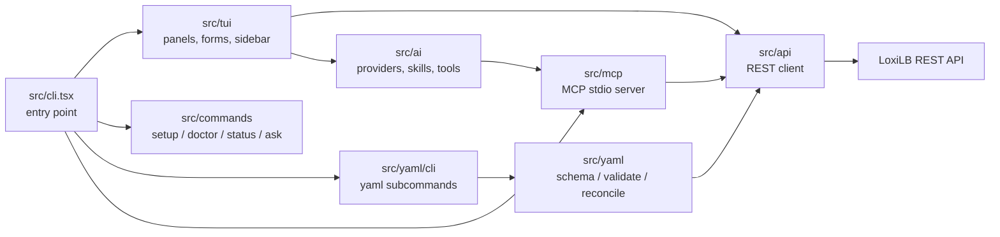

# Developer Guide

This guide explains how loxitui is structured, how to set up a development environment,
and how the test, schema-generation, and release pipelines work. It is written for
contributors and maintainers; if you just want to *use* loxitui, start with the
[README](../README.md).

## Architecture Overview

loxitui is a single Bun/TypeScript process. `src/cli.tsx` is the entry point: it parses
the subcommand, loads `~/.config/loxitui/config.toml`, initializes the audit logger, and
either renders the TUI (default), runs a headless CLI command, or starts the MCP stdio
server (`--mcp-server`).



### Module map (`src/`)

| Module | Responsibility | Key entry points |
|---|---|---|
| `src/api/` | Typed REST client for the LoxiLB API. One file per resource domain (lb, endpoint, conntrack, route, cluster, bgp, bfd, ipsec, security, ports, status, log, trace, network, ai-gateway). All requests return an `ApiResult` discriminated union — no thrown errors on HTTP failure. | `src/api/index.ts` (`LoxilbApi` facade), `src/api/client.ts` |
| `src/tui/` | The interactive terminal UI, built on `@opentui/react`. `panels/` holds the monitoring panels, `forms/` the CRUD dialogs, `components/` shared widgets (command palette, search bar, markdown renderer), `sidebar/` the optional AI sidebar, `commands/` the in-TUI command parser/dispatcher. | `src/tui/App.tsx`, `src/tui/state.tsx` |
| `src/ai/` | Optional AI assistant: provider abstraction (`provider/` — `claude-cli`, `ollama`), read-only tool registry shared with the MCP server (`tools.ts`), skill routing (`skills.ts`), knowledge retrieval (`knowledge-matcher.ts`), system-prompt construction, history summarization. | `src/ai/client.ts`, `src/ai/provider/registry.ts` |
| `src/yaml/` | Declarative YAML configuration engine: JSON-Schema validation (`schema/`, `validator/`), per-resource API adapters (`adapters/`), plan/diff/apply reconciler (`reconciler/`), live-state export (`export/`), snapshot history and rollback (`versioning/`), and the `loxitui yaml` CLI (`cli/`). | `src/yaml/cli/index.ts` |
| `src/commands/` | Headless CLI subcommands: `setup` (interactive wizard), `doctor` (connectivity checks), `status` (live state, `--output json`), `ask` (one-shot AI query). | `src/commands/index.ts` |
| `src/config/` | Config loading and validation. TOML is parsed with `smol-toml` and validated with the Zod schema in `schema.ts`; defaults live in `types.ts`. | `src/config/index.ts` (`loadConfig`) |
| `src/metrics/` | Prometheus scraping: text-format parser, polling loop, ring-buffer timeline store, and sparkline rendering for the Metrics panel. | `src/metrics/poller.ts`, `src/metrics/store.ts` |
| `src/audit/` | Structured NDJSON audit logging with size-based rotation and token redaction. `types.ts` is a discriminated union of every audit event. | `src/audit/logger.ts`, `src/audit/index.ts` |
| `src/knowledge/` | Locates and loads the bundled `loxilb-knowledge/` markdown corpus. | `src/knowledge/resolve.ts`, `src/knowledge/loader.ts` |
| `src/mcp/` | The Model Context Protocol stdio server (`loxitui --mcp-server`) that exposes the read-only tool registry to MCP clients. See [docs/mcp-server.md](mcp-server.md). | `src/mcp/server.ts` |
| `src/cmd/` | Verb/resource command parser and executor used by the TUI command palette (e.g. `list lb`, `delete route`). | `src/cmd/parser.ts`, `src/cmd/executor.ts` |
| `src/utils/` | Small shared helpers (logging, fuzzy search). | `src/utils/log.ts`, `src/utils/search.ts` |

Two deliberate seams worth knowing about:

- The AI assistant is **optional by design**: every panel, form, and CLI command must
  work with no provider configured (see [docs/ai-sidebar.md](ai-sidebar.md)).
- `src/ai/knowledge-matcher.ts` exposes a pluggable `GraphKnowledgeService` interface so
  an external graph-augmented retrieval provider can be injected; when none is
  registered, retrieval is keyword-only.

## Development Environment

Requirements: [Bun](https://bun.sh) **1.3.6 or newer** (pinned in `package.json`
`engines` and in CI). No Node.js or npm needed.

```bash
git clone https://github.com/loxilb-io/loxitui.git
cd loxitui
bun install
```

Common tasks (defined in `package.json` and the `Makefile`):

| Command | What it does |
|---|---|
| `bun run dev` / `make dev` | Run the TUI with live reload (`bun --watch`) |
| `bun run start` | Run the TUI once from source |
| `bun test` / `make test` | Run the full test suite |
| `bun run typecheck` | `tsc --noEmit` strict type check |
| `bun run lint` / `make lint` | Biome lint + format check (`biome.json`) |
| `bun run build` / `make build` | Compile a standalone binary (`dist/loxitui` or `bin/loxitui`) |
| `make install-user` | Install the compiled binary to `~/.local/bin` |

All four of `typecheck`, `lint`, `test`, and `build` must pass before opening a PR —
CI enforces each of them.

## Test Suite

Tests live in `tests/` and run with `bun test`. The layout mirrors `src/`: flat files
for core modules (`tests/api.test.ts`, `tests/config.test.ts`, `tests/audit.test.ts`,
`tests/cmd.test.ts`, `tests/metrics.test.ts`, `tests/knowledge-matcher.test.ts`,
`tests/dispatcher.test.ts`, `tests/integration.test.ts`) and a `tests/yaml/` tree for
the YAML engine (adapters, reconciler, validator, versioning, CLI, plus fixtures).

```bash
bun test                       # everything (hermetic; E2E auto-skips)
bun test tests/yaml            # one subtree
bun test tests/config.test.ts  # one file
```

### Live-gateway E2E suite (`tests/e2e/`)

The unit suite never touches the network. Real-gateway coverage lives in
`tests/e2e/` and is **opt-in** via `LOXITUI_E2E_HOST` — without it the suite
skips, so `bun test` stays hermetic everywhere.

Four layers: a read sweep over every endpoint the TUI polls (core endpoints
must succeed; feature-gated ones — BGP, BFD, trace — may return a structured
feature-disabled error but **never 404**, which is what catches path drift),
an LB CRUD round-trip on the spec delete paths, a YAML adapter round-trip
(create → diff sees it live → delete), and the config lifecycle documents.
Fixtures use TEST-NET-1 (`192.0.2.0/24`) addresses and clean up after
themselves.

```bash
# against any reachable gateway (e.g. a local container):
docker run --privileged -d -p 11111:11111 \
  ghcr.io/loxilb-io/loxilb-inference-gateway:latest-u24
bun run test:e2e               # LOXITUI_E2E_HOST=127.0.0.1 is set by CI; set it yourself locally
LOXITUI_E2E_HOST=127.0.0.1 bun test tests/e2e

# full practical cycle against the remote testbed (gateway container up,
# compiled binary shipped over SSH, CLI driven remotely, suite through a tunnel):
TESTBED_HOST=<host> TESTBED_USER=<user> bun run test:e2e:testbed
```

`scripts/e2e-testbed.sh` takes authentication from the environment (ssh-agent,
`~/.ssh/config`, or `SSHPASS=... SSH_CMD="sshpass -e ssh"`) — no credentials
in the repo.

### The global spy-restore preload

`bunfig.toml` preloads `tests/setup.ts` before every test file:

```ts
import { afterEach, mock } from "bun:test";

afterEach(() => {
  mock.restore();
});
```

This exists because **`bun test` executes files in filesystem-discovery order, which is
platform-dependent** (macOS and Linux CI enumerate directories differently). Several
suites spy on shared singletons (e.g. the schema registry and adapter registry) in
`beforeEach` without restoring; a leaked spy would poison whichever files happen to run
later — on one platform but not the other. The global `afterEach(mock.restore)` makes
test order irrelevant. If you add tests that use `spyOn`, you can rely on this hook; do
not remove it.

### Coverage gate

CI runs `scripts/coverage-gate.sh` instead of a bare `bun test`. It runs
`bun test --coverage`, parses the "All files" line-coverage percentage, and fails the
build if it is below the floor (default **60%**, overridable with `COVERAGE_FLOOR`):

```bash
./scripts/coverage-gate.sh
COVERAGE_FLOOR=65 ./scripts/coverage-gate.sh
```

The floor is a **ratchet**: it started just below the measured baseline and only ever
moves up as coverage improves. Never lower it to make CI pass — add tests instead.

## Schema Generation Pipeline

The YAML engine validates every resource kind against JSON Schemas generated from the
LoxiLB Swagger 2.0 spec:

```text
swagger_new.yml
   │  bun scripts/generate-schemas.ts
   ▼
src/yaml/schema/generated/      ← one .json per resource kind + index.ts barrel
```

`scripts/generate-schemas.ts` extracts the POST body definitions for the 35
resource kinds (34 configurable, plus the read-only `EndpointHostState`),
resolves `$ref` chains, converts them to JSON Schema
draft 2020-12, and writes the files plus a barrel `index.ts`.

Rules for working with this pipeline:

- **Generated files are committed.** The `schema-drift` job in CI regenerates them and
  fails on `git diff --exit-code src/yaml/schema/generated` — if you change
  `swagger_new.yml` or the generator, rerun `bun scripts/generate-schemas.ts` and commit
  the result in the same PR.
- **Never hand-edit** anything under `src/yaml/schema/generated/`.
- Biome excludes the generated tree (`files.ignore` in `biome.json`), so lint noise
  from generated code is not a concern.

Validated by: `tests/yaml/generate-schemas.test.ts`, `tests/yaml/schema-validation.test.ts`.

## Cross-Compilation

Release builds compile standalone binaries for four targets with
`bun build --compile --target=bun-<os>-<arch>` (see the `build:*` scripts in
`package.json`).

The catch: the TUI depends on platform-specific native packages
(`@opentui/core-<os>-<arch>`), and **`bun install` skips packages whose `os`/`cpu`
fields don't match the host** — so on a fresh checkout, cross-builds fail because the
target platform's package was never installed. `scripts/fetch-platform-deps.sh` fixes
this by downloading the missing platform packages directly from the npm registry (no
install scripts run) and unpacking them into `node_modules`:

```bash
./scripts/fetch-platform-deps.sh                  # all four platforms (CI release build)
./scripts/fetch-platform-deps.sh core-linux-arm64 # just one (used by the Dockerfile)
bun run build:linux-arm64
```

The version is read from the exact pin in `package.json`, which is the single source of
truth. The script needs only `bun` and `tar`, so it also works inside the `oven/bun`
container.

## CI Workflows (`.github/workflows/`)

| Workflow | File | Purpose |
|---|---|---|
| CI | `ci.yml` | Six jobs: Biome lint + typecheck (`quality`), workflow lint (`actionlint`), tests behind the coverage gate (`test`), generated-schema drift check (`schema-drift`), live-gateway E2E (`e2e-gateway`), and cross-platform binary builds with a smoke test of the native binary (`build`) |
| E2E Testbed | `e2e-testbed.yml` | **Primary live coverage.** Nightly + manual: full practical cycle on the hardware testbed — compiled binary shipped over SSH, CLI driven against the remote gateway, `tests/e2e` through a tunnel. Needs `TESTBED_HOST`/`TESTBED_USER`/`TESTBED_SSH_KEY` secrets; skips cleanly when absent |
| Release-Hygiene | `hygiene.yml` | Runs `scripts/release-hygiene.sh` — blocks internal hostnames, personal paths, AI-attribution trailers, secrets, links to non-public docs, tracked private paths, and missing governance files |
| DCO | `dco.yml` | Verifies every PR commit carries the `Signed-off-by` trailer required by CONTRIBUTING.md (`git commit -s`) |
| Dependency Audit | `audit.yml` | `bun audit` dependency vulnerability scan |
| CodeQL | `codeql.yml` | Static security analysis |
| Secret Scan | `gitleaks.yml` | Gitleaks scan over history |
| Build Image | `build-image.yml` | Multi-arch container image build (amd64/arm64), Cosign-signed |
| Release | `release.yml` | Tagged releases: binaries for all four targets, `SHA256SUMS`, SPDX SBOM, SLSA provenance |

All CI runs pin the Bun version (`BUN_VERSION` in `ci.yml`) and use
`bun install --frozen-lockfile`.

## Contributing

See [CONTRIBUTING.md](../CONTRIBUTING.md) for the full contribution flow — the
pull request process, DCO sign-off, and review requirements. The short version:
branch off `main`, keep changes focused, make `typecheck` + `lint` + `test` + `build`
pass, and update `docs/` when you change public behavior.

## Related Documentation

- [README](../README.md) — features, installation, quick start
- [AI sidebar](ai-sidebar.md) — the optional AI assistant
- [MCP server](mcp-server.md) — `loxitui --mcp-server` mode and tool catalog
